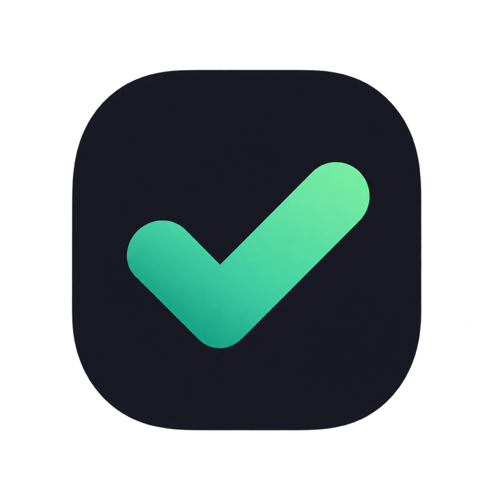

# Done — Habit & Productivity Tracker

<p align="center">
  
</p>

<p align="center">
  <strong>A premium, private, local-first desktop application for deep focus, habit building, and personal recovery.</strong>
</p>

<p align="center">
  
  
  
  
  
  
  
</p>

---

## 🌟 Overview

**Done** is an all-in-one personal operating system engineered for individuals who value focus, self-discipline, and continuous self-improvement. It uniquely harmonizes high-yield productivity tools (Kanban, Pomodoro, long-term goals) with evidence-based behavioral psychology and recovery tracking.

**100% Local-First:** Your data is stored exclusively on your personal device in an embedded SQLite database. No mandatory cloud accounts, no third-party telemetry, and no tracking.

---

## ✨ Key Features

### 🍅 1. Pomodoro Focus Engine & Companion
- **Adaptive Timer:** 25m Focus, 50m Deep Work, or custom intervals with audio feedback.
- **Desktop Companion Integration:**
  - **macOS Menu Bar:** Real-time countdown timer displayed directly in Apple's top menu bar (`🍅 24:59`).
  - **Windows Taskbar:** Interactive green progress bar overlaid on the Windows taskbar icon.
- **Floating Mini-Pill:** Minimized overlay allowing you to work across apps without losing track of time.

### 📋 2. Kanban Task Workflow
- **Visual Task Board:** Manage tasks across `Backlog`, `Todo`, `In Progress`, and `Done` columns with smooth drag-and-drop (`@hello-pangea/dnd`).
- **Priority Matrix:** Filter instantly by `High`, `Medium`, and `Low` priorities.
- **Integrated Pomodoro Counter:** Increments completed sessions directly on each task card.

### 🎯 3. Long-Term Goals & Milestones
- **Categorized Goals:** Organize ambitions across Career, Health, Recovery, Personal, and General domains.
- **Visual Progress Tracking:** Track milestones, target deadlines, and progress bars.
- **Automatic Deadline Notifications:** Global modal alerts you when a goal reaches its target date, offering one-click completion or flexible deadline extension.

### ⚡ 4. Spotlight Quick-Add HUD
- **Global Shortcut:** Press **`Cmd + Shift + Space`** (macOS) or **`Ctrl + Shift + Space`** (Windows) from *any* application to instantly summon the floating Spotlight HUD.
- **Quick-Action:** Rapidly capture tasks, log notes, or trigger the emergency protocol without switching windows.
- **In-App Summoning:** Also accessible inside the app with **`Cmd/Ctrl + K`**.

### 🛡️ 5. Sobriety & Habit Recovery Tracker
- **Real-Time Streak Counter:** Live days, hours, and minutes tracking with motivational milestone badges.
- **Urge Resistance Diary:** Log urges with triggers, emotional intensity, and coping strategies.
- **One-Touch Emergency Protocol (SOS):** Press **`Cmd/Ctrl + E`** to launch a full-screen de-escalation suite including:
  - 4-7-8 Breathing pacemaker.
  - 5-4-3-2-1 Grounding exercise.
  - Personal emergency contacts and core motivation affirmations.

### 📖 6. Daily Journal & Structured Reflections
- **Morning Focus:** Set 1 to 3 primary daily intentions at the start of your day.
- **Automated Accomplishments Feed:** Automatically aggregates completed tasks and checked habits in real time.
- **Evening Reflection Banner:** Smart contextual banner reminding you from 20:00 to 23:59 to capture lessons and celebrate daily wins.

### 📊 7. Deep Analytics & Insights
- **Mood & Energy Trends:** Track daily mood (1–5) and energy levels with chart visualizations.
- **Habit Consistency Grid:** Weekly and monthly completion heatmaps.
- **Recovery Health Metrics:** Resistance rate analysis and sobriety longevity graphs.

### 🔒 8. Security & App-Level Privacy
- **PIN Lock:** Optional 4–6 digit PIN with secure `bcrypt` hashing that locks the screen on startup or after inactivity.
- **One-Click JSON Backup & Restore:** Export or import your entire history with native file dialogs.

### 🌐 9. Full Internationalization (i18n)
- Native bilingual support for **Tiếng Việt** and **English** with seamless real-time switching.

---

## 🖥️ Cross-Platform Desktop Architecture

Done is engineered to feel completely native on both major desktop platforms:

| Platform | Window Style | System Integration | Key Bindings |
| :--- | :--- | :--- | :--- |
| **macOS** *(Intel & Apple Silicon M1–M4)* | Native Traffic Lights (`hiddenInset`), Under-Window Vibrancy Blur | Menu Bar countdown (`tray.setTitle`), Dock Badging (`app.dock.setBadge`), Native Edit Menu | `⌘ + Shift + Space`<br>`⌘ + E`<br>`⌘ + K` |
| **Windows** *(10 & 11)* | Custom Frameless Dark TitleBar, Windows 11 Acrylic Blur | Taskbar Progress Bar (`window.setProgressBar`), System Tray Companion | `Ctrl + Shift + Space`<br>`Ctrl + E`<br>`Ctrl + K` |

---

## 🛠️ Tech Stack

- **Application Shell:** [Electron 39](https://www.electronjs.org/) + [electron-vite](https://electron-vite.org/)
- **UI Framework:** [React 19](https://react.dev/) + [TypeScript 5.9](https://www.typescriptlang.org/)
- **Styling:** [Tailwind CSS v4](https://tailwindcss.com/) + Custom Glassmorphic Deep Space Design System
- **Animation:** [Framer Motion](https://www.framer.com/motion/)
- **Database:** [SQLite](https://www.sqlite.org/) via [Prisma ORM 6](https://www.prisma.io/)
- **Data Management:** [TanStack Query v5](https://tanstack.com/query) + [Zustand](https://github.com/pmndrs/zustand)
- **Internationalization:** [i18next](https://www.i18next.com/) + [react-i18next](https://react.i18next.com/)
- **Icons & UI Primitives:** [Lucide React](https://lucide.dev/) + [Radix UI](https://www.radix-ui.com/) + [Sonner](https://sonner.emilkowal.ski/)

---

## 🚀 Getting Started

### Prerequisites
- **Node.js:** v20.x or later (LTS recommended)
- **npm:** v10.x or later

### Installation

1. **Clone the repository:**
   ```bash
   git clone https://github.com/Tomwakeupat530amm/Habit-recovery.git
   cd Habit-recovery
   ```

2. **Install dependencies:**
   ```bash
   npm install
   ```

3. **Generate Prisma Client & Engines:**
   ```bash
   npx prisma generate
   ```

4. **Initialize Database Template (if needed):**
   ```bash
   npm run build:db
   ```

5. **Start Development App:**
   ```bash
   npm run dev
   ```

---

## 📦 Building for Production

### Build Windows Installer (.exe)
```bash
npm run build:win
```
*Output: `dist/Done-Setup-<version>.exe` (NSIS Installer)*

### Build macOS Application (.dmg)
```bash
npm run build:mac
```
*Output: `dist/Done-<version>-<arch>.dmg` (Universal Intel & Apple Silicon)*

### Multi-OS Automated Cloud Builds (GitHub Actions)
This repository includes an automated CI/CD pipeline at `.github/workflows/build.yml`. Every commit pushed to `main` spins up official **Windows** and **macOS** runners in the cloud, compiling clean binaries available for download in your GitHub **Actions** tab under **Artifacts**.

> **💡 macOS Gatekeeper Note:** If distributing unsigned `.dmg` files to Mac users without an Apple Developer certificate, users can open the app by right-clicking `Done.app` ➔ **Open**, or running `xattr -cr /Applications/Done.app` in Terminal.

---

## 📁 Project Structure

```
Habit-recovery/
├── .github/workflows/         # CI/CD multi-OS cloud build matrix (Win + Mac)
├── build/                     # App packaging resources
│   ├── entitlements.mac.plist # macOS Hardened Runtime security entitlements
│   └── icon.png               # High-res application icon (512x512)
├── prisma/                    # Database layer
│   ├── schema.prisma          # Prisma schema with multi-target binary configs
│   ├── dev.db                 # Local development SQLite database
│   └── prod.db                # Clean production database template
├── src/
│   ├── main/                  # Electron Main Process
│   │   ├── database/          # PrismaClient singleton & dynamic engine loader
│   │   ├── ipc/               # IPC domain handlers (tasks, habits, goals, etc.)
│   │   ├── services/          # Business logic & desktop companion services
│   │   │   ├── badge.service.ts      # Dock badge & Taskbar progress
│   │   │   ├── quick-add.service.ts  # Global shortcut HUD service
│   │   │   ├── tray.service.ts       # Menu Bar & System Tray companion
│   │   │   └── notification.service.ts# Scheduled reminders
│   │   └── index.ts           # Main window lifecycle & application menu
│   ├── preload/               # Preload scripts (secure contextBridge)
│   ├── renderer/src/          # React 19 Frontend
│   │   ├── assets/            # Styles (Tailwind v4 theme) & icons
│   │   ├── components/        # Layouts, TitleBar, QuickAddModal, LockScreen
│   │   ├── features/          # Feature modules (goals, tasks, habits, journal)
│   │   ├── locales/           # i18n translation dictionaries (en.json, vi.json)
│   │   ├── pages/             # Main route pages (Dashboard, Tasks, Habits, etc.)
│   │   └── stores/            # Zustand state stores
│   └── shared/                # Cross-process TypeScript types & DTOs
├── electron-builder.yml       # Production packaging specifications
├── electron.vite.config.ts    # Build & bundling configuration
└── package.json
```

---

## 📄 License

This project is licensed under the [MIT License](LICENSE).
