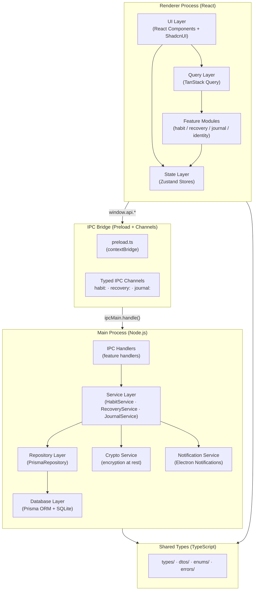
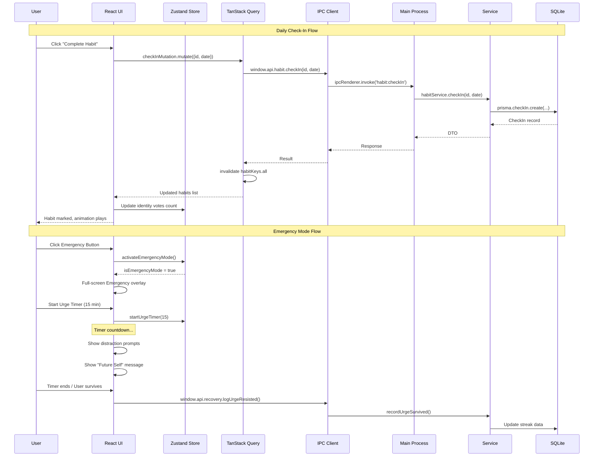

# System Architecture Document
# Atomic Recovery — Electron Desktop App

**Version:** 1.0.0  
**Stack:** Electron-Vite · Electron · React · TypeScript · ShadcnUI · Tailwind CSS · Zustand · TanStack Query · Prisma · SQLite · Framer Motion · Lucide React

---

## 1. Architecture Philosophy

Atomic Recovery sử dụng **Clean Architecture** kết hợp **Feature-Based Structure**:

- **Clean Architecture**: tách biệt business logic khỏi framework và UI. Core không phụ thuộc vào Electron, React, hay Prisma — chỉ phụ thuộc vào abstraction.
- **Feature-Based**: code được tổ chức theo tính năng (habit, recovery, journal...) thay vì theo loại file (components, services, hooks). Mỗi feature là một module độc lập.
- **Electron-aware separation**: Main Process và Renderer Process hoàn toàn tách biệt, giao tiếp chỉ qua IPC layer được type-safe.

> **Lý do:** Desktop app với sensitive data cần kiến trúc rõ ràng. Khi scale (thêm AI local, sync, v.v.), Clean Architecture cho phép swap layer mà không rewrite business logic.

---

## 2. System Architecture Diagram



---

## 3. Dependency Rules

```
UI Components        →  Feature Hooks / Stores
Feature Hooks        →  IPC Client (window.api)
IPC Client           →  [BOUNDARY] Preload Bridge
Preload Bridge       →  [BOUNDARY] IPC Channels
IPC Handlers         →  Services
Services             →  Repositories (interface)
Repositories         →  Prisma / SQLite
Services             →  Crypto, Notifications
All Layers           →  Shared Types (read-only)
```

**Quy tắc cứng:**
- Renderer KHÔNG bao giờ import từ Main Process.
- Main Process KHÔNG bao giờ import React.
- Services KHÔNG biết về IPC — chỉ biết interface.
- Repositories là implementation detail của Services.
- Shared Types không có logic — chỉ là contract.

---

## 4. Folder Structure

```
atomic-recovery/
├── electron/                          # Main Process
│   ├── main.ts                        # Entry point
│   ├── app/
│   │   ├── window.ts                  # BrowserWindow factory
│   │   ├── tray.ts                    # System tray
│   │   └── protocol.ts               # Custom protocol (security)
│   ├── ipc/
│   │   ├── index.ts                   # Register all handlers
│   │   ├── habit.handler.ts
│   │   ├── recovery.handler.ts
│   │   ├── journal.handler.ts
│   │   ├── identity.handler.ts
│   │   ├── analytics.handler.ts
│   │   └── settings.handler.ts
│   ├── services/
│   │   ├── habit.service.ts
│   │   ├── recovery.service.ts
│   │   ├── journal.service.ts
│   │   ├── identity.service.ts
│   │   ├── analytics.service.ts
│   │   ├── notification.service.ts
│   │   ├── crypto.service.ts
│   │   └── backup.service.ts
│   ├── repositories/
│   │   ├── interfaces/
│   │   │   ├── habit.repository.interface.ts
│   │   │   └── recovery.repository.interface.ts
│   │   ├── habit.repository.ts
│   │   ├── recovery.repository.ts
│   │   ├── journal.repository.ts
│   │   ├── identity.repository.ts
│   │   └── analytics.repository.ts
│   └── database/
│       ├── prisma.client.ts           # Singleton PrismaClient
│       ├── migrations/               # Migration files
│       └── seed.ts                   # Dev seed data
│
├── src/                               # Renderer Process (React)
│   ├── main.tsx                       # React entry
│   ├── App.tsx                        # Router + Providers
│   ├── ipc/
│   │   └── client.ts                  # window.api wrapper (typed)
│   ├── features/
│   │   ├── habit/
│   │   │   ├── components/
│   │   │   │   ├── HabitCard.tsx
│   │   │   │   ├── HabitForm.tsx
│   │   │   │   ├── HabitList.tsx
│   │   │   │   └── StreakCalendar.tsx
│   │   │   ├── hooks/
│   │   │   │   ├── useHabits.ts
│   │   │   │   ├── useCheckIn.ts
│   │   │   │   └── useStreak.ts
│   │   │   ├── stores/
│   │   │   │   └── habit.store.ts
│   │   │   ├── queries/
│   │   │   │   └── habit.queries.ts   # TanStack Query definitions
│   │   │   └── index.ts
│   │   ├── recovery/
│   │   │   ├── components/
│   │   │   │   ├── SobrietyCounter.tsx
│   │   │   │   ├── RelapseModal.tsx
│   │   │   │   ├── EmergencyMode.tsx
│   │   │   │   ├── UrgeTimer.tsx
│   │   │   │   └── MilestoneCard.tsx
│   │   │   ├── hooks/
│   │   │   │   ├── useSobriety.ts
│   │   │   │   ├── useEmergency.ts
│   │   │   │   └── useRelapse.ts
│   │   │   ├── stores/
│   │   │   │   └── recovery.store.ts
│   │   │   ├── queries/
│   │   │   │   └── recovery.queries.ts
│   │   │   └── index.ts
│   │   ├── identity/
│   │   │   ├── components/
│   │   │   │   ├── FutureSelfProfile.tsx
│   │   │   │   ├── IdentityVotes.tsx
│   │   │   │   └── Affirmations.tsx
│   │   │   ├── hooks/
│   │   │   ├── stores/
│   │   │   │   └── identity.store.ts
│   │   │   └── index.ts
│   │   ├── journal/
│   │   │   ├── components/
│   │   │   │   ├── DailyCheckin.tsx
│   │   │   │   ├── MoodPicker.tsx
│   │   │   │   ├── TriggerLog.tsx
│   │   │   │   └── JournalEntry.tsx
│   │   │   ├── hooks/
│   │   │   ├── stores/
│   │   │   └── index.ts
│   │   ├── analytics/
│   │   │   ├── components/
│   │   │   │   ├── HeatmapCalendar.tsx
│   │   │   │   ├── TrendChart.tsx
│   │   │   │   ├── MoodCorrelation.tsx
│   │   │   │   └── WeeklySummary.tsx
│   │   │   ├── hooks/
│   │   │   └── index.ts
│   │   └── settings/
│   │       ├── components/
│   │       │   ├── SecuritySettings.tsx
│   │       │   ├── NotificationSettings.tsx
│   │       │   └── ThemeSettings.tsx
│   │       └── index.ts
│   ├── stores/
│   │   ├── app.store.ts               # Global app state (lock, theme, nav)
│   │   └── ui.store.ts                # UI state (modals, toasts)
│   ├── components/
│   │   ├── ui/                        # ShadcnUI base components
│   │   ├── layout/
│   │   │   ├── Sidebar.tsx
│   │   │   ├── AppShell.tsx
│   │   │   └── TopBar.tsx
│   │   └── shared/
│   │       ├── EmergencyButton.tsx    # Global emergency button
│   │       ├── LockScreen.tsx
│   │       └── OnboardingGuard.tsx
│   ├── pages/
│   │   ├── DashboardPage.tsx
│   │   ├── HabitsPage.tsx
│   │   ├── RecoveryPage.tsx
│   │   ├── JournalPage.tsx
│   │   ├── AnalyticsPage.tsx
│   │   ├── IdentityPage.tsx
│   │   └── SettingsPage.tsx
│   ├── lib/
│   │   ├── utils.ts                   # cn(), formatDate(), etc.
│   │   ├── constants.ts
│   │   └── theme.ts
│   └── router/
│       └── index.tsx                  # React Router config
│
├── shared/                            # Shared between Main + Renderer
│   ├── types/
│   │   ├── habit.types.ts
│   │   ├── recovery.types.ts
│   │   ├── journal.types.ts
│   │   ├── identity.types.ts
│   │   └── analytics.types.ts
│   ├── dtos/
│   │   ├── habit.dto.ts
│   │   ├── recovery.dto.ts
│   │   └── journal.dto.ts
│   ├── enums/
│   │   ├── HabitFrequency.ts
│   │   ├── MoodState.ts
│   │   ├── RecoveryMilestone.ts
│   │   └── TriggerType.ts
│   └── errors/
│       └── AppError.ts
│
├── prisma/
│   ├── schema.prisma
│   └── migrations/
│
├── electron.vite.config.ts
├── tsconfig.json
├── tailwind.config.ts
└── package.json
```

---

## 5. Database Schema (Prisma)

```prisma
// prisma/schema.prisma

generator client {
  provider = "prisma-client-js"
  output   = "../electron/database/generated"
}

datasource db {
  provider = "sqlite"
  url      = "file:./atomic-recovery.db"
}

model Identity {
  id            String   @id @default(cuid())
  name          String                         // "Người đàn ông kỷ luật"
  description   String?
  photoPath     String?
  values        String                         // JSON array
  affirmations  String                         // JSON array
  createdAt     DateTime @default(now())
  updatedAt     DateTime @updatedAt
}

model RecoverySession {
  id            String        @id @default(cuid())
  startedAt     DateTime
  endedAt       DateTime?
  isActive      Boolean       @default(true)
  relapses      Relapse[]
}

model Relapse {
  id            String          @id @default(cuid())
  sessionId     String
  session       RecoverySession @relation(fields: [sessionId], references: [id])
  occurredAt    DateTime        @default(now())
  triggerType   String?         // TriggerType enum as string
  triggerNote   String?
  urgeIntensity Int?            // 1-10
  recoveryNote  String?
}

model Habit {
  id            String        @id @default(cuid())
  name          String
  description   String?
  icon          String?
  color         String?
  frequency     String        // HabitFrequency enum
  scheduledTime String?       // "07:00"
  category      String?
  isArchived    Boolean       @default(false)
  stackedAfter  String?       // Habit id (habit stacking)
  createdAt     DateTime      @default(now())
  checkIns      CheckIn[]
}

model CheckIn {
  id            String    @id @default(cuid())
  habitId       String
  habit         Habit     @relation(fields: [habitId], references: [id])
  date          String    // "2026-08-16" — date string for easier querying
  completedAt   DateTime  @default(now())
  note          String?
}

model DailyEntry {
  id            String    @id @default(cuid())
  date          String    @unique  // "2026-08-16"
  morningNote   String?
  eveningNote   String?
  mood          Int?      // 1-5
  energy        Int?      // 1-5
  gratitude     String?   // JSON array of strings
  wins          String?   // JSON array
  freeJournal   String?
  createdAt     DateTime  @default(now())
  updatedAt     DateTime  @updatedAt
}

model TriggerLog {
  id            String    @id @default(cuid())
  loggedAt      DateTime  @default(now())
  triggerType   String
  intensity     Int
  context       String?
  action        String?   // what they did instead
  outcome       String?   // resisted / relapsed
}

model Milestone {
  id            String    @id @default(cuid())
  days          Int
  achievedAt    DateTime  @default(now())
  celebrated    Boolean   @default(false)
}

model Settings {
  id                String    @id @default("singleton")
  theme             String    @default("dark")
  accentColor       String    @default("#6366f1")
  language          String    @default("vi")
  pinHash           String?
  notificationsOn   Boolean   @default(true)
  morningReminderAt String?
  eveningReminderAt String?
  highRiskTimes     String?   // JSON
  encryptionEnabled Boolean   @default(false)
  updatedAt         DateTime  @updatedAt
}
```

---

## 6. IPC Layer Design

### Channel Naming Convention
```
{feature}:{action}

Examples:
  habit:getAll
  habit:create
  habit:checkIn
  recovery:getActiveSession
  recovery:logRelapse
  journal:saveDailyEntry
  settings:update
```

### Preload Bridge (type-safe)

```typescript
// electron/preload.ts
import { contextBridge, ipcRenderer } from 'electron'
import type { IpcChannels } from '../shared/types/ipc.types'

const api: IpcChannels = {
  habit: {
    getAll: () => ipcRenderer.invoke('habit:getAll'),
    create: (dto) => ipcRenderer.invoke('habit:create', dto),
    checkIn: (id, date) => ipcRenderer.invoke('habit:checkIn', id, date),
    delete: (id) => ipcRenderer.invoke('habit:delete', id),
  },
  recovery: {
    getActiveSession: () => ipcRenderer.invoke('recovery:getActiveSession'),
    logRelapse: (dto) => ipcRenderer.invoke('recovery:logRelapse', dto),
    getStreakDays: () => ipcRenderer.invoke('recovery:getStreakDays'),
  },
  journal: {
    getDailyEntry: (date) => ipcRenderer.invoke('journal:getDailyEntry', date),
    saveDailyEntry: (dto) => ipcRenderer.invoke('journal:saveDailyEntry', dto),
  },
  analytics: {
    getHeatmap: (year) => ipcRenderer.invoke('analytics:getHeatmap', year),
    getWeeklySummary: () => ipcRenderer.invoke('analytics:getWeeklySummary'),
  },
  settings: {
    get: () => ipcRenderer.invoke('settings:get'),
    update: (dto) => ipcRenderer.invoke('settings:update', dto),
  },
}

contextBridge.exposeInMainWorld('api', api)
```

### IPC Handler (example)

```typescript
// electron/ipc/habit.handler.ts
import { ipcMain } from 'electron'
import { HabitService } from '../services/habit.service'

export function registerHabitHandlers(service: HabitService) {
  ipcMain.handle('habit:getAll', async () => {
    return service.getAllHabits()
  })

  ipcMain.handle('habit:create', async (_, dto: CreateHabitDto) => {
    return service.createHabit(dto)
  })

  ipcMain.handle('habit:checkIn', async (_, id: string, date: string) => {
    return service.checkIn(id, date)
  })
}
```

---

## 7. Service Layer

```typescript
// electron/services/recovery.service.ts
export class RecoveryService {
  constructor(
    private readonly repo: IRecoveryRepository,
    private readonly notify: NotificationService,
  ) {}

  async getStreakDays(): Promise<number> {
    const session = await this.repo.getActiveSession()
    if (!session) return 0
    const diff = Date.now() - new Date(session.startedAt).getTime()
    return Math.floor(diff / (1000 * 60 * 60 * 24))
  }

  async logRelapse(dto: LogRelapseDto): Promise<void> {
    // 1. Close current session
    await this.repo.closeActiveSession()
    // 2. Log relapse with context
    await this.repo.createRelapse(dto)
    // 3. Start fresh session
    await this.repo.startNewSession()
    // 4. No shame notification — just acknowledgment
    this.notify.send({
      title: 'Tiếp tục hành trình',
      body: 'Bạn đã ghi nhận điều này. Mỗi khoảnh khắc là một khởi đầu mới.',
    })
  }

  async checkMilestones(streakDays: number): Promise<Milestone | null> {
    const milestones = [1, 3, 7, 14, 30, 60, 90, 180, 365]
    if (milestones.includes(streakDays)) {
      return this.repo.recordMilestone(streakDays)
    }
    return null
  }
}
```

---

## 8. State Management (Zustand)

### Pattern: feature stores + global store

```typescript
// src/stores/app.store.ts
interface AppState {
  isLocked: boolean
  isOnboarded: boolean
  theme: 'dark' | 'light'
  accentColor: string
  activeFeature: string
  // Actions
  unlock: () => void
  lock: () => void
  setTheme: (theme: string) => void
}

export const useAppStore = create<AppState>()(
  persist(
    (set) => ({
      isLocked: true,
      isOnboarded: false,
      theme: 'dark',
      accentColor: '#6366f1',
      activeFeature: 'dashboard',
      unlock: () => set({ isLocked: false }),
      lock: () => set({ isLocked: true }),
      setTheme: (theme) => set({ theme }),
    }),
    { name: 'app-store' }  // persisted in localStorage (non-sensitive only)
  )
)

// src/features/recovery/stores/recovery.store.ts
interface RecoveryState {
  streakDays: number
  isEmergencyMode: boolean
  activeUrgeTimer: number | null
  // Actions
  setStreakDays: (days: number) => void
  activateEmergencyMode: () => void
  deactivateEmergencyMode: () => void
  startUrgeTimer: (minutes: number) => void
}
```

### TanStack Query cho server-state (IPC calls)

```typescript
// src/features/habit/queries/habit.queries.ts
export const habitKeys = {
  all: ['habits'] as const,
  detail: (id: string) => ['habits', id] as const,
  checkIns: (date: string) => ['habits', 'checkIns', date] as const,
}

export function useHabits() {
  return useQuery({
    queryKey: habitKeys.all,
    queryFn: () => window.api.habit.getAll(),
    staleTime: 30_000,
  })
}

export function useCheckInMutation() {
  const queryClient = useQueryClient()
  return useMutation({
    mutationFn: ({ id, date }: { id: string; date: string }) =>
      window.api.habit.checkIn(id, date),
    onSuccess: () => {
      queryClient.invalidateQueries({ queryKey: habitKeys.all })
    },
  })
}
```

> **Lý do dùng cả Zustand + TanStack Query:**
> - Zustand: UI state + client state không có server (emergency mode, lock state, theme)
> - TanStack Query: Tất cả data từ SQLite qua IPC — caching, background refetch, optimistic updates

---

## 9. Data Flow Diagram



---

## 10. Module Structure & Dependency Graph

```
shared/
  types/         ← no dependencies
  dtos/          ← depends on types/
  enums/         ← no dependencies
  errors/        ← no dependencies

electron/
  database/      ← depends on prisma (external)
  repositories/  ← depends on database/, shared/
  services/      ← depends on repositories/ (interfaces), shared/
  ipc/           ← depends on services/, shared/
  main.ts        ← depends on ipc/, app/

src/
  lib/           ← no app dependencies
  stores/        ← depends on lib/, shared/
  features/*/
    queries/     ← depends on ipc/client.ts, shared/
    stores/      ← depends on shared/
    hooks/       ← depends on queries/, stores/
    components/  ← depends on hooks/, lib/, ui/
  pages/         ← depends on features/*/components
  App.tsx        ← depends on pages/, stores/, components/layout/
```

---

## 11. Security Architecture

```
┌─────────────────────────────────────────────────────┐
│  Application Lock (PIN Hash → bcrypt)               │
│  ┌─────────────────────────────────────────────┐   │
│  │  Data Layer (SQLite)                         │   │
│  │  Optional: SQLCipher encryption at rest      │   │
│  │  ┌──────────────────────────────────────┐   │   │
│  │  │  IPC: contextIsolation: true          │   │   │
│  │  │        nodeIntegration: false         │   │   │
│  │  │        sandbox: true                  │   │   │
│  │  └──────────────────────────────────────┘   │   │
│  └─────────────────────────────────────────────┘   │
│  No network requests. No analytics. Offline only.   │
└─────────────────────────────────────────────────────┘
```

**BrowserWindow security config:**
```typescript
new BrowserWindow({
  webPreferences: {
    preload: path.join(__dirname, 'preload.js'),
    contextIsolation: true,      // Renderer cannot access Node
    nodeIntegration: false,      // Renderer cannot use require()
    sandbox: true,               // Extra OS-level isolation
  },
})
```

---

## 12. Architecture Decisions & Rationale

| Decision | Rationale |
|----------|-----------|
| **Electron-Vite** vs plain Electron | Hot reload, fast build, modern bundling — developer experience |
| **SQLite + Prisma** vs IndexedDB | Main process owns DB — more control, encryption, migrations, raw SQL when needed |
| **TanStack Query cho IPC** | IPC calls behave like async APIs — TQ's caching/invalidation/optimistic updates fit perfectly |
| **Zustand cho UI state** | Minimal boilerplate, no actions/reducers verbosity, TypeScript-first |
| **Feature-Based folders** | Easier to reason about ownership, easier to delete/add features, co-location of related code |
| **Shared types package** | Single source of truth — Main and Renderer agree on contracts, no drift |
| **contextBridge** (không window.electron) | Security best practice — renderer cannot access Node APIs directly |
| **Framer Motion** | Recovery UX cần animations có cảm xúc (milestone celebrations, emergency overlay transitions) |
| **Local SQLite, no cloud** | Privacy is non-negotiable. Sensitive data stays on device. |
